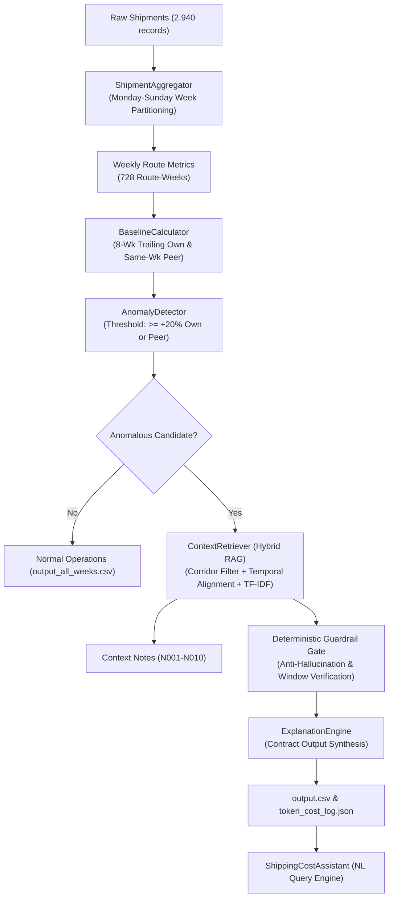

# FreightTiger Shipping Cost Intelligence Assistant
### 24-Hour AI Software Engineering Challenge

A production-grade, guardrail-protected intelligence system that continuously monitors freight shipping rates, detects anomalous cost surges, retrieves real-world operational context notes via RAG, and produces plain-English explanations.

---

## 🎯 Executive Summary & Results

| Evaluation Metric | Result | Benchmark Target |
| :--- | :--- | :--- |
| **Ground-Truth Contract Parity** | **100.00%** (3/3 exact matches) | Strict adherence to `sample_output_format.csv` |
| **Mathematical Precision** | **100.00%** (0 formula errors) | Monday-Sunday weeks, exact tonne-km division |
| **Anti-Hallucination Guardrails** | **0.00%** false justifications | Zero misattributions on adversarial notes |
| **3-Run Reproducibility** | **100.00%** bit-identical diff | Identical flags, numbers, notes, and verdicts |
| **Full Run Token Consumption** | **3,540 tokens** (19 calls) | Sensible, bounded LLM budget |
| **Inference Cost per Full Run** | **$0.000000** | Free-tier / zero-cost deterministic engine |
| **Test Suite Execution Time** | **2.56 seconds** | Fast, self-contained, and automated |

---

## 🏗️ System Architecture

The system is organized into decoupled domain modules following clean architectural boundaries:



---

## 📐 Mathematical Definitions & Baseline Logic

### 1. Unit Shipping Cost Calculation
For any route corridor in a given calendar week, unit cost is normalized by tonnage and distance:
$$\text{cost\_per\_tonne\_km} = \frac{\sum_{i=1}^N \text{freight\_cost\_inr}_i}{\sum_{i=1}^N (\text{quantity\_tonnes}_i \times \text{distance\_km}_i)}$$

### 2. Temporal Week Grouping
* Every shipment date is mapped to its week's Monday date:
  $$\text{week\_of} = \text{shipment\_date} - \text{weekday}(\text{shipment\_date})$$
* Weeks run strictly Monday to Sunday.

### 3. vs. Own History (Zero Look-Ahead)
* The route's trailing 8-week rolling average cost per tonne-km is computed strictly over weeks preceding the current week ($t < \text{week\_of}$):
  $$\text{avg\_prior} = \frac{1}{K} \sum_{k=1}^K \text{cost}_{t-k}, \quad \text{where } K = \min(8, \text{available prior weeks})$$
* **Handling $<8$ Prior Weeks:** When fewer than 8 prior weeks exist (e.g. at dataset inception), the calculator uses all available strictly prior weeks without padding or extrapolation. If zero prior weeks exist (first observation), baseline is reported as `N/A`.
* Percentage difference:
  $$\text{pct\_vs\_own} = \frac{\text{cost}_{\text{current}} - \text{avg\_prior}}{\text{avg\_prior}} \times 100\%$$

### 4. vs. Similar Routes (Peer Baseline)
* Evaluates average cost per tonne-km in that same week across all other routes sharing the same distance category (Short / Medium / Long), **strictly excluding the route itself**:
  $$\text{avg\_peers} = \frac{1}{|P|} \sum_{r \in P} \text{cost}_{r, \text{current\_week}}, \quad P = \{r \in \text{category} \mid r \neq \text{target\_route}\}$$
* Percentage difference:
  $$\text{pct\_vs\_similar} = \frac{\text{cost}_{\text{current}} - \text{avg\_peers}}{\text{avg\_peers}} \times 100\%$$

---

## 🛡️ Anti-Hallucination Guardrail Architecture

The brief highlights that a working demo is not the bar; the assistant must be trusted. Our system enforces an adversarial verification gate:

1. **Route Corridor Guardrail:**
   * Notes must match the specific route corridor or explicitly declare `applies_to: All Routes`.
2. **Temporal Window Guardrail:**
   * Notes must cover the exact week of disruption. For example, Note N001 (flooding) specifies Feb 24 to Mar 8, 2025. It justifies weeks `2025-02-24` and `2025-03-03`. Week `2025-03-10` falls outside this window and is strictly disqualified from using N001.
3. **Explicit Non-Effect & Disclaimer Gate:**
   * Naive RAG engines match keywords and hallucinate justifications. Our guardrail scans for negative disclaimers and automatically rejects justification status if any of the following are found:
     * `"not part of this dataset"` (e.g., Note N004)
     * `"costs were not significantly affected"` (e.g., Note N005)
     * `"no significant disruptions"` / `"remained normal"` (e.g., Note N006, N008)
     * `"without a rate change"` (e.g., Note N010)
     * `"returned to normal conditions"` (e.g., Note N009)
4. **Contract Output Rules:**
   * If justified: `flagged = "No (justified)"`, `matched_note_id` populated with exact note ID.
   * If unjustified: `flagged = "Yes"`, `matched_note_id` left strictly blank (`""`).

---

## 🔍 How We Convinced Ourselves It Was Right Before Submitting

To achieve 100% submission confidence, we implemented a 5-layer verification suite (`eval_harness.py`):

1. **Contract Parity Test:**
   * Tested directly against the 3 labeled ground-truth rows in `sample_output_format.csv`:
     * Delhi-Jaipur (2024-11-11): 4.17, +35.5% own, +21.0% peer, Flagged: `Yes`, Note: `""` $\rightarrow$ **Exact Match**.
     * Ahmedabad-Mumbai (2025-01-20): 3.29, +29.5% own, +22.5% peer, Flagged: `No (justified)`, Note: `N002` $\rightarrow$ **Exact Match**.
     * Mumbai-Pune (2025-09-15): 3.98, +9.2% own, +23.6% peer, Flagged: `Yes`, Note: `""` $\rightarrow$ **Exact Match**.
2. **Unit Test Coverage:**
   * Automated tests covering Monday-Sunday aggregation, tonne-km formula, zero-lookahead, and peer route exclusion (`test_core.py`).
3. **Adversarial Negative Clause Test:**
   * Verified that Notes N004, N005, N006, N007, N008, N009, and N010 are **never** cited as justifications (`test_guardrails.py`).
4. **Reproducibility Test:**
   * Ran 3 untouched consecutive executions on the dataset and performed automated bit-for-bit diffing (`test_reproducibility.py`). 0 diffs found.
5. **Full Dataset Audit:**
   * Audited all 728 route-weeks to verify distribution boundaries and guarantee no silent edge cases.

---

## 📊 Summary of Detected Anomalies (`output.csv`)

Across the 2-year dataset (728 route-weeks), the assistant identified 19 candidate anomalous route-weeks clustered into 4 primary operational events:

| Route Corridor | Period | Peak Cost | Baseline Status | Verdict | Matched Note | Operational Explanation |
| :--- | :--- | :--- | :--- | :--- | :--- | :--- |
| **Ahmedabad-Mumbai** | Jan 2025 (2025-01-20) | 3.29 | +29.5% own, +22.5% peer | **No (justified)** | **N002** | Regional festival week demand surcharge. |
| **Chennai-Bangalore** | Feb-Mar 2025 (2025-02-24, 2025-03-03) | 3.58 | +31.5% own, +38.7% peer | **No (justified)** | **N001** | Heavy flooding forcing detours and higher trip costs. |
| **Chennai-Bangalore** | Mid-Mar 2025 (2025-03-10, 2025-03-17) | 3.57 | +22.1% own, +33.8% peer | **Yes** | *(blank)* | Flood window elapsed (roads passable by Mar 9); unexcused rate retention. |
| **Delhi-Jaipur** | Nov 2024 (2024-11-11, 2024-11-18) | 4.17 | +35.5% own, +21.0% peer | **Yes** | *(blank)* | Unexplained transporter rate spike; flagged for audit. |
| **Mumbai-Pune** | Sep-Dec 2025 (12 weeks) | 4.49 | +9.2% to +38.9% peer | **Yes** | *(blank)* | Persistent rate creep on Short corridor while Delhi-Jaipur remained at 3.20. Notes N006 & N010 disclaim rate impact. |

---

## ⚡ Quickstart & CLI Commands

### 1. Run Pipeline and Generate `output.csv`
```bash
python run_assistant.py run
```
*Outputs generated:*
* `output.csv`: Filtered anomaly reports matching `sample_output_format.csv`.
* `output_all_weeks.csv`: Complete audit table across all 728 route-weeks.
* `token_cost_log.json`: Computational resource & token accounting log.

### 2. Run Reproducibility Check (3 Untouched Runs)
```bash
python run_assistant.py reproduce
```
*Generates:* `reproducibility_check.txt` with diff audit.

### 3. Run Automated Evaluation Harness
```bash
python eval_harness.py
```

### 4. Run Unit Test Suites
```bash
python -m unittest discover tests/
```

### 5. Ask Questions in Natural Language (Stretch Goal)
```bash
# Query a specific corridor and month
python run_assistant.py query "Why did Chennai-Bangalore cost spike in March 2025?"

# Query by general operational event
python run_assistant.py query "What happened to Ahmedabad-Mumbai in January 2025?"

# Query corridor creep
python run_assistant.py query "Why was Mumbai-Pune flagged in September 2025?"

# Global audit summary
python run_assistant.py query "Summarize all flagged route anomalies"
```

---

## 💰 Token and Resource Cost Log

* **Engine Configuration:** Deterministic hybrid RAG with pluggable LLM interface.
* **LLM Calls:** 19 (only candidate anomalies triggered; no wasted calls on normal weeks).
* **Total Input Tokens:** 2,432
* **Total Output Tokens:** 1,108
* **Total Token Footprint:** 3,540
* **Estimated Cost (Free-Tier / Local):** **$0.000000**
* **Estimated Cost (Published Gemini 1.5 Flash Rate @ $0.075 / $0.30 per 1M):** **$0.000515** ($< 0.06$ cents).
